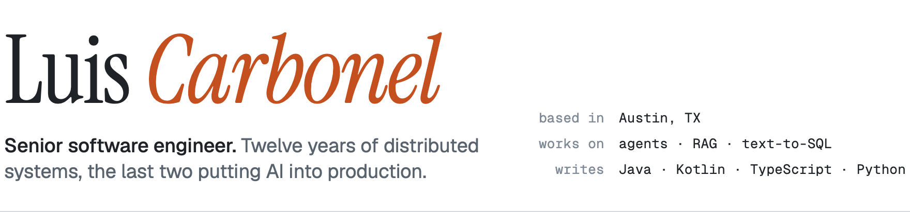
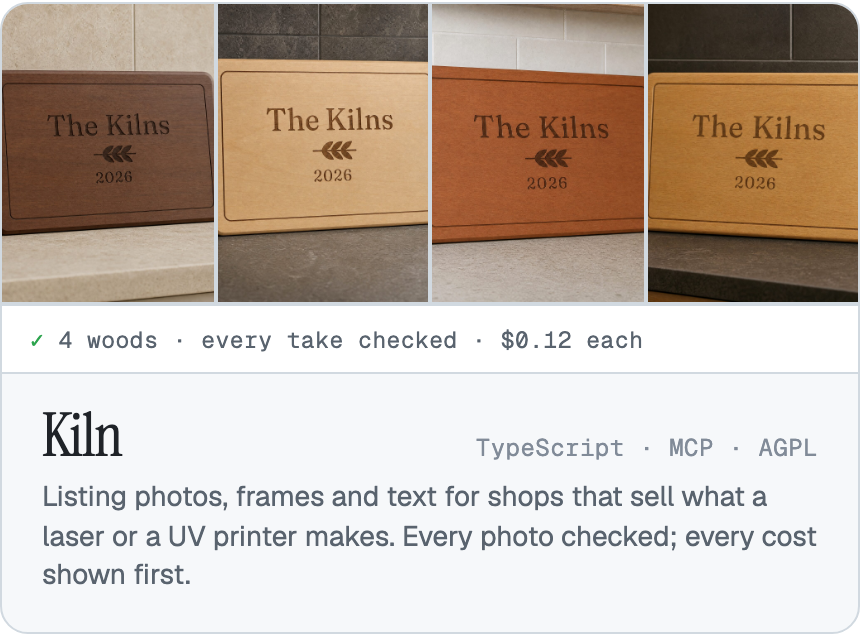
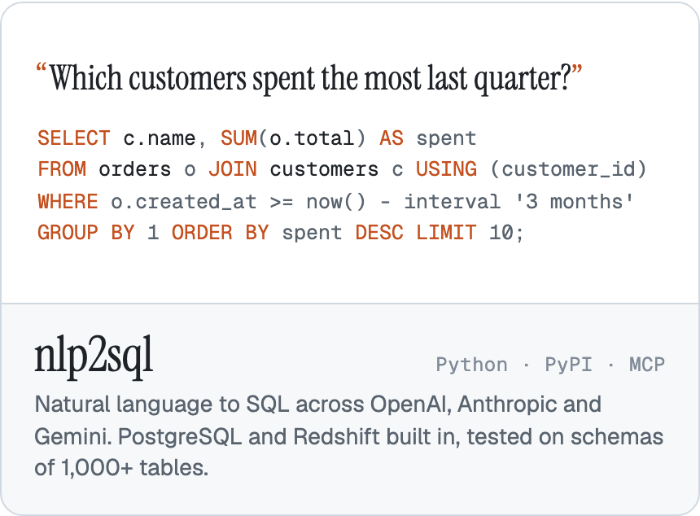

<picture>
  <source media="(prefers-color-scheme: dark)" srcset="assets/header-dark.png">
  
</picture>

 

I build backend systems that carry real load, mostly in Java and Kotlin, and lately the AI that runs inside them. Here I build tools in the open: each one solves a problem I hit at work or around it, and each is meant to be used, not just read.

### Building in the open

<table>
  <tr>
    <td width="50%" valign="top">
      <a href="https://github.com/luiscarbonel1991/kiln">
        <picture>
          <source media="(prefers-color-scheme: dark)" srcset="assets/kiln-dark.png">
          
        </picture>
      </a>
      

        <a href="https://github.com/luiscarbonel1991/kiln"><b>Repository</b></a> ·
        <a href="https://luiscarbonel1991.github.io/kiln/"><b>See what it makes</b></a>
      

    </td>
    <td width="50%" valign="top">
      <a href="https://github.com/luiscarbonel1991/nlp2sql">
        <picture>
          <source media="(prefers-color-scheme: dark)" srcset="assets/nlp2sql-dark.png">
          
        </picture>
      </a>
      

        <a href="https://github.com/luiscarbonel1991/nlp2sql"><b>Repository</b></a> ·
        <a href="https://pypi.org/project/nlp2sql/"><b>PyPI</b></a>
      

    </td>
  </tr>
</table>

### Experience

Twelve years across event-driven microservices, data pipelines and, for the last two, AI platforms in production: a multi-agent system serving **1M+ queries a day at 99.9% uptime**, with the RAG and natural-language-to-SQL layers underneath it. I have shipped two SaaS products from zero to production, led teams, mentored engineers and run hiring.

**Hiring?** The full story is in my [CV](https://cv.devlach.com), and I'm reachable on [LinkedIn](https://www.linkedin.com/in/luiscarbonel91/).

### Stack

`Java` `Kotlin` `TypeScript` `Python` · `Spring` `Ktor` `Vert.x` `Next.js` `React` `FastAPI` · `PostgreSQL` `pgvector` `Redshift` `Kafka` · `AWS` `Bedrock` `Docker` · `OpenAI` `Anthropic` `Gemini`

### Elsewhere

[CV](https://cv.devlach.com) · [LinkedIn](https://www.linkedin.com/in/luiscarbonel91/) · [Writing at devlach.com](https://devlach.com) · devhighlevel@gmail.com
